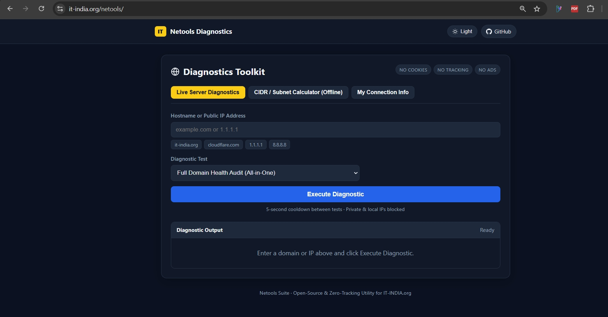
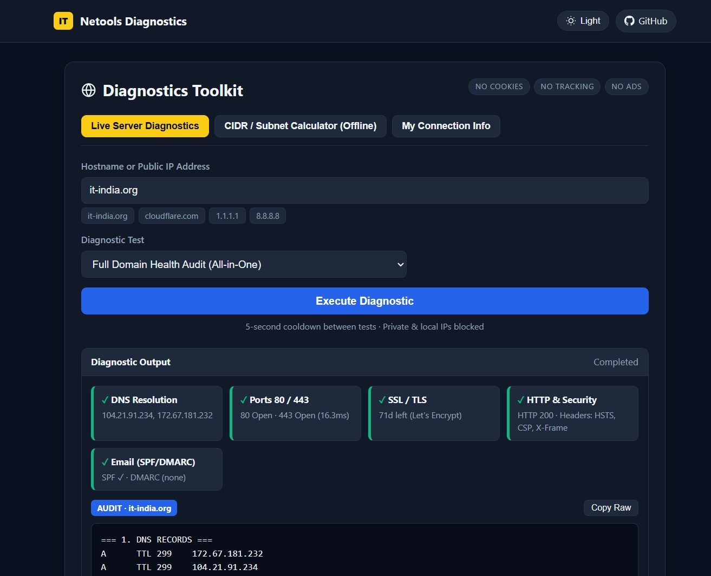
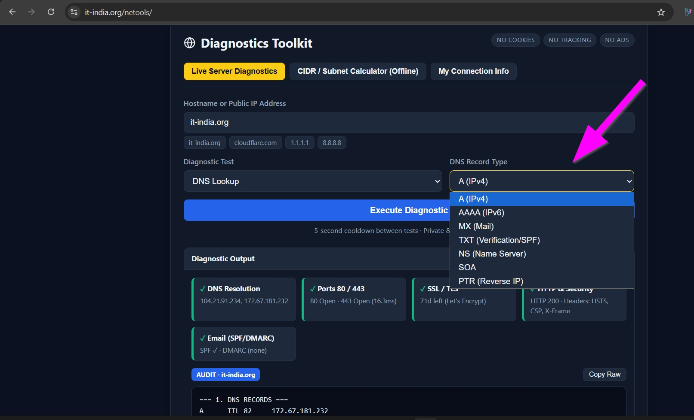
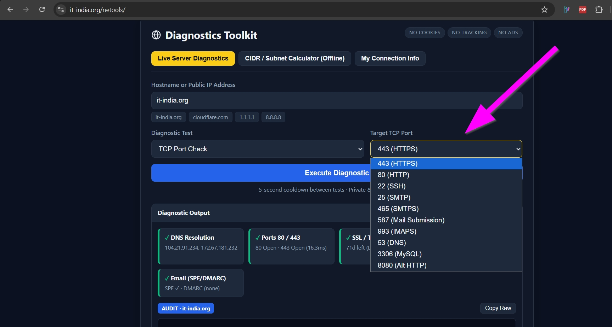

# Network-Tools (Netools v2.0)

A lightweight, self-hosted network diagnostics suite built in pure PHP and vanilla JavaScript—designed for **zero cookies, zero tracking, zero database overhead, and zero external CDN dependencies**.

Live demo: **[it-india.org/netools](https://it-india.org/netools/)**



---

## Core Principles

* **Zero Cookies & Zero Tracking:** Uses stateless HMAC-signed tokens instead of PHP sessions—no `PHPSESSID` cookie is ever sent to visitors, and no query logs or raw IP addresses are stored.
* **Zero External Dependencies:** Self-contained CSS, inline SVGs, and vanilla JavaScript. No Bootstrap, jQuery, or third-party font CDNs required.
* **Portable by Design:** Automatically uses native Linux CLI utilities (`dig`, `whois`, `traceroute`, `ping`) when available, and seamlessly falls back to pure PHP (`dns_get_record`, `fsockopen`, port-43 sockets, PHP streams) on Windows/XAMPP or restricted shared hosting.
* **Built-in SSRF & Abuse Protection:** Blocks private, loopback, and reserved IPv4/IPv6 ranges (`127.0.0.0/8`, `10.0.0.0/8`, `172.16.0.0/12`, `192.168.0.0/16`, `169.254.0.0/16`, `::1`, `fc00::/7`) on both raw IP inputs and resolved hostnames, paired with rate-limiting and honeypot checks.

---

## Screenshots

| Full Domain Health Audit | Diagnostic Output & Details |
| :---: | :---: |
|  |  |
| **Additional Diagnostics** | **Offline Utilities & Theme Support** |
|  |  |

---

## Included Tools

### Server-Side Diagnostics
1. **Full Domain Health Audit (All-in-One):** Checks DNS `A` resolution, TCP ports `80` & `443`, SSL/TLS expiry & issuer, HTTP status & security headers (`HSTS`, `CSP`, `X-Frame-Options`), and `SPF`/`DMARC` records in a single run with Pass/Warn/Fail summary cards.
2. **DNS Lookup:** Structured `A`, `AAAA`, `MX`, `TXT`, `NS`, `SOA`, and `PTR` queries with TTL and priority values.
3. **Email Auth Inspector (SPF & DMARC):** Audits `MX` records, `v=spf1` syntax, and `_dmarc` enforcement policies (`reject`, `quarantine`, `none`).
4. **SSL / TLS Certificate Inspector:** Displays Subject CN, Issuer, validity countdown, negotiated TLS protocol/cipher, handshake latency, and Subject Alternative Names (SANs).
5. **HTTP Header & Redirect Tracer:** Follows redirect hops, measures total response time, and prints raw response headers.
6. **TCP Port Check:** Tests reachability and latency across common web, mail, SSH, DNS, and database ports.
7. **Ping & WHOIS Lookup:** ICMP reachability (with automatic TCP fallback) and domain registration records.
8. **Live Streamed Traceroute:** Real-time hop-by-hop output via Server-Sent Events (`text/event-stream`).

### Client-Side Utilities (100% Offline)
* **IPv4 CIDR / Subnet Calculator:** Instant network address, netmask, wildcard mask, broadcast address, and usable host range calculation in the browser.
* **My Connection Info:** Displays the visitor's public IP, reverse DNS (`PTR`), viewport size, and timezone locally without logging.

---

## Quick Installation

1. **Clone or download** this repository into your web server's document root (e.g., `/var/www/html/netools`):
   ```bash
   git clone [https://github.com/AdminArorA007/Network-Tools.git](https://github.com/AdminArorA007/Network-Tools.git) netools